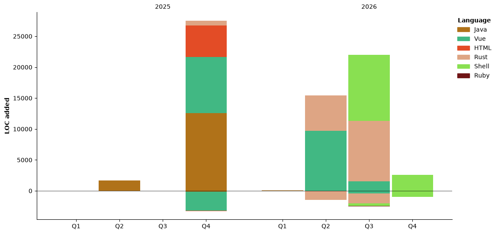

## Recent Digests

> From Douban

<!-- DOUBAN-POST-LIST:START -->
- [最近在读统治与教育](https://book.douban.com/subject/26675905/) - 2026-08-31
- [看过蜘蛛侠：崭新之日](https://movie.douban.com/subject/36246195/) - 2026-08-12
- [想读低能儿收容所](https://book.douban.com/subject/20501529/) - 2026-07-30
- [看过记忆碎片](https://movie.douban.com/subject/1304447/) - 2026-06-01
- [在看同乐者 第一季](https://movie.douban.com/subject/36352371/) - 2025-11-29

<!-- DOUBAN-POST-LIST:END -->

> Listening now

[](https://spotify-github-profile.kittinanx.com/api/view?uid=31btad7bicxtayw57fcr4h6gomfm&redirect=true)

## Coding This Week

<!--START_SECTION:waka-->


**I'm an Early 🐤** 

```text
🌞 Morning                78 commits          ██░░░░░░░░░░░░░░░░░░░░░░░   08.70 % 
🌆 Daytime                387 commits         ███████████░░░░░░░░░░░░░░   43.14 % 
🌃 Evening                343 commits         ██████████░░░░░░░░░░░░░░░   38.24 % 
🌙 Night                  89 commits          ██░░░░░░░░░░░░░░░░░░░░░░░   09.92 % 
```
📅 **I'm Most Productive on Saturday** 

```text
Monday                   276 commits         ████████░░░░░░░░░░░░░░░░░   30.77 % 
Tuesday                  48 commits          █░░░░░░░░░░░░░░░░░░░░░░░░   05.35 % 
Wednesday                24 commits          █░░░░░░░░░░░░░░░░░░░░░░░░   02.68 % 
Thursday                 102 commits         ███░░░░░░░░░░░░░░░░░░░░░░   11.37 % 
Friday                   37 commits          █░░░░░░░░░░░░░░░░░░░░░░░░   04.12 % 
Saturday                 285 commits         ████████░░░░░░░░░░░░░░░░░   31.77 % 
Sunday                   125 commits         ███░░░░░░░░░░░░░░░░░░░░░░   13.94 % 
```


📊 **This Week I Spent My Time On** 

```text
🕑︎ Time Zone: Asia/Hong_Kong

💬 Programming Languages: 
Objective-C              4 hrs 13 mins       █████░░░░░░░░░░░░░░░░░░░░   20.73 % 
C                        4 hrs 2 mins        █████░░░░░░░░░░░░░░░░░░░░   19.81 % 
Makefile                 2 hrs 56 mins       ████░░░░░░░░░░░░░░░░░░░░░   14.41 % 
Markdown                 2 hrs 47 mins       ███░░░░░░░░░░░░░░░░░░░░░░   13.69 % 
Java                     2 hrs 12 mins       ███░░░░░░░░░░░░░░░░░░░░░░   10.83 % 

🔥 Editors: 
Claude Code              16 hrs 25 mins      ████████████████████░░░░░   80.56 % 
IntelliJ IDEA            2 hrs 2 mins        ██░░░░░░░░░░░░░░░░░░░░░░░   10.00 % 
Emacs                    53 mins             █░░░░░░░░░░░░░░░░░░░░░░░░   04.40 % 
Neovim                   24 mins             ░░░░░░░░░░░░░░░░░░░░░░░░░   01.97 % 
Vim                      19 mins             ░░░░░░░░░░░░░░░░░░░░░░░░░   01.60 % 

💻 Operating System: 
Mac                      20 hrs 22 mins      █████████████████████████   100.00 % 
```

🤖 **AI Coding This Week** 

```text
⏱ AI Coding Time: 16 hrs 41 mins (81.92%)

✍️ 2,557 lines written by AI, 43 lines written by hand (98.35% AI-written)

🔤 750,748 Input Tokens, 977,900 Output Tokens

💵 $0.00 Estimated AI Cost This Week

🧠 9 AI Sessions, 66 AI Prompts

🔎 AI Coding Insights:
🤖 AI-Driven — 98.35% of written lines came from AI
📄 Detailed Prompter — average 673 characters per prompt
🔁 Iterative Prompter — average 7 prompts per session
🚀 High AI Trust — 1.57% of changed lines were hand-edited
```

**I Mostly Code in Java** 

```text
Rust                     3 repos             ██████░░░░░░░░░░░░░░░░░░░   23.08 % 
Shell                    2 repos             ████░░░░░░░░░░░░░░░░░░░░░   15.38 % 
Vue                      2 repos             ████░░░░░░░░░░░░░░░░░░░░░   15.38 % 
Ruby                     1 repo              ██░░░░░░░░░░░░░░░░░░░░░░░   07.69 % 
HTML                     1 repo              ██░░░░░░░░░░░░░░░░░░░░░░░   07.69 % 
```


**Timeline**




 Last Updated on 01/11/2026 05:46:04 UTC
<!--END_SECTION:waka-->
